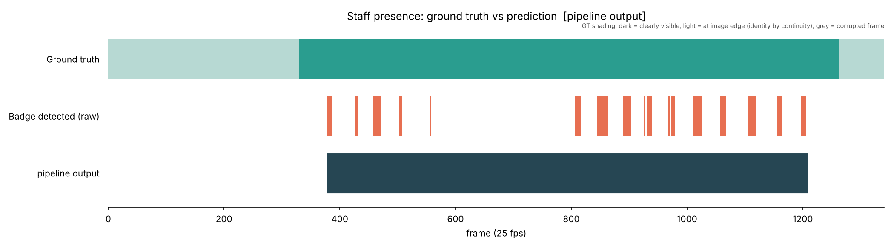

# Staff identification in a top-down sensor clip

The clip is 54 seconds of a fisheye top-down office with about fifteen people, one of whom wears a staff name tag. For
every frame the output is whether that person is in view and where. The tag is roughly 15 by 6 pixels and faces the
sensor in about 15% of frames. The staff member changes from a white shirt to a black jacket half-way through the clip.

## Approach

Three stages: track people, detect the tag inside each person box, select the staff trajectory as the best path
through the person boxes.

Ultralytics YOLO26n with OC-SORT tracks everyone. The tracker thresholds are lowered because COCO scores top-down
people at only 0.1 to 0.3. Each person box is cropped and passed to a second, one-class YOLO26n trained to find the
tag; after cropping the tag is about 40 pixels at the detector input. Training data came from the clip itself, 91
boxes over two rounds, hand-labelled first and then model-proposed and checked, plus hard negatives the first model
fired on. On held-out crops the detector finds the tag 96% of the time with no false alarms on bystanders.

The tracker loses the staff member whenever he runs, so his track comes in about 14 pieces. A dynamic programme finds
one path through all the person boxes. A box earns its tag score; a step costs for moving faster than 30 pixels a
frame, 0.02 per skipped frame up to 40, and 1.0 for jumping to a different person. The highest-scoring path is the
staff trajectory. Frames on it are "present", skipped frames are interpolated, and the path must contain at least five
sightings, so a clip with no staff returns nothing. Nothing in the pipeline depends on clothing.

## Results

Measured against a per-frame reference for the clip (`data/ground_truth.csv`, 932 clearly-visible frames).

| | recall | x,y on the right person (within 80 px) |
|---|---|---|
| tag seen in the frame, nothing else | 19.2 % | 28.7 % |
| full pipeline | 89.4 % | 94.9 % |

Sightings come in bursts; the path turns them into continuous presence, including the 200 frames at the desk where
the tag is hidden.
